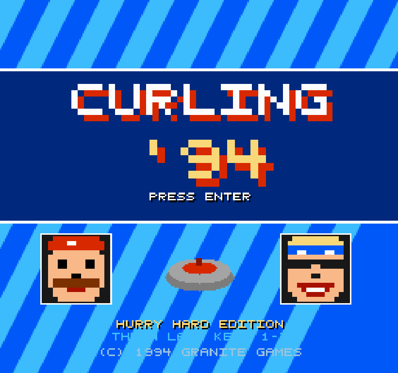
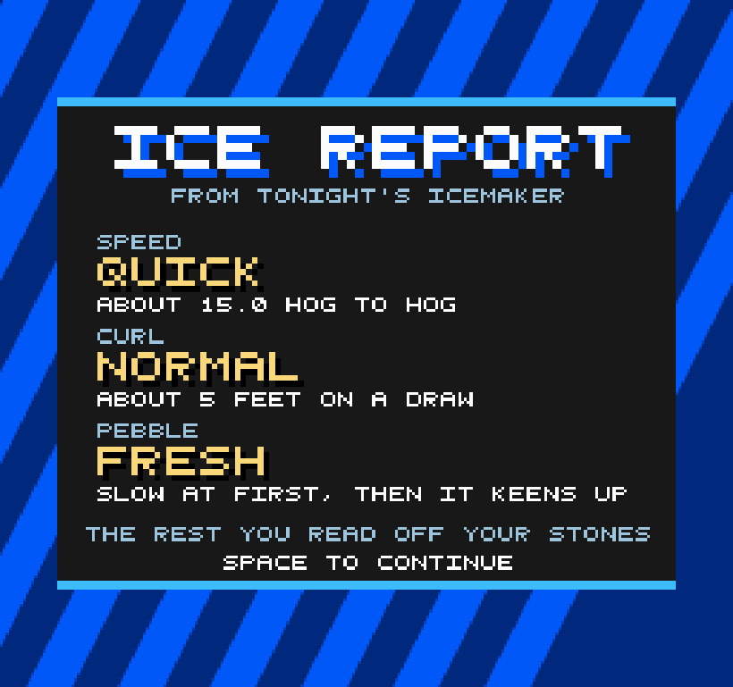
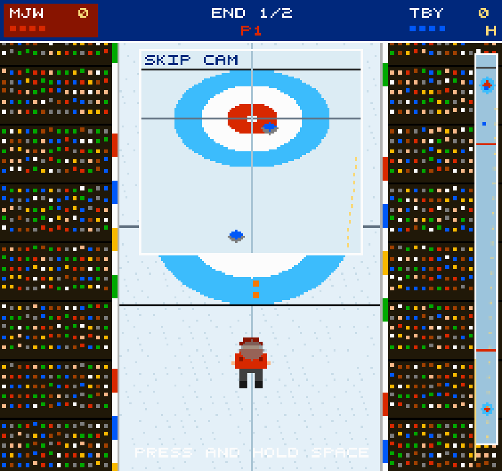

# CURLING '94

*HURRY HARD EDITION — © 1994 GRANITE GAMES*

A 90s-arcade curling game in the spirit of the 16-bit golden age: the
vertical-scrolling rink, crowd and rink-board ads of **NHL '94**, the
oscillating aim-arrow / power-meter mechanics of **Madden field goals**,
and the big flashing splash screens, skip portraits and trash talk of
**Punch-Out!!** and **Windjammers** — all rendered at a chunky 256×240
with a 5×5 pixel font and Web Audio chiptune bleeps.

Underneath the pixels the stones obey real curling physics.

| | | | |
|---|---|---|---|
|  |  |  |  |

## Play it

No build step, no dependencies. Either open `index.html` directly, or:

```sh
python3 -m http.server 8000
# then visit http://localhost:8000
```

## How to play

**MOOSE JAW** (red) vs **THUNDER BAY** (blue). Throw your stones down the
sheet; closest to the button scores. Most points after the final end wins
(ties go to an extra end).

Each throw is a field-goal routine, then a mash-to-sweep ride:

| Phase  | What happens | Controls |
|--------|--------------|----------|
| HANDLE | Commit to the turn first: counter-clockwise curls left, clockwise curls right | `←` / `→`, then `SPACE` |
| AIM    | The broom swings left and right | press and **hold** `SPACE` to lock it |
| WEIGHT | The unmarked weight bar climbs once while you hold | **let go** to throw (holding to the top throws full weight) |
| SWEEP  | Stone is away! Sweeping carries it farther and straighter | mash `SPACE` (or `Z`/`X`) |

`ENTER` starts/advances menus. In the setup menu choose VS CPU or
2-player hot seat, stones per team per end (2/4/8), number of ends, and
the ice: LIVING or PERFECT.

## Living ice

On LIVING ice every game is played on a different sheet, and the sheet
changes as you play:

- The **ice report** before the game gives the icemaker's rounded
  figures for speed and curl. Most sheets run about 14.0 seconds
  hog-to-hog; some run about 13.5 or 15.0.
- The pebble is **fresh**: the first stones run 0.6-0.9 seconds slower
  than the report, and the sheet keens up over the next handful. In a
  long game it eventually breaks down, slower and straighter.
- It is **not uniform**: there are keen and heavy patches, the outside
  edges are frosty, one side swings more than the other, and the lane
  stones keep travelling gets quicker and straighter.
- The weight bar never changes: the same position is always the same
  throw. Read the sheet and adjust.

Two things show you what the ice is doing. After every stone the
stopwatch adds an **ICE** read: what that line is running at, in
hog-to-hog seconds for a draw to the button, whatever weight you threw.
And after each end the **ice log** charts every read so far against the
icemaker's report.

For testing the model there is an **ice lab**: `I` overlays the truth
on the sheet (speed map, then curl map, then off), and with it on `]`
ages the pebble by one stone without throwing.

The CPU skip gets the same report and has to learn the sheet by
watching stones, like you. PERFECT ice is the uniform nominal sheet.

While you aim, the **skip cam** shows the far end close up, stretching
down the sheet to include any guards, with your broom line through it.
The minimap on the right shows the whole sheet, every stone, and your
**broom line** while you aim — a straight line, like a skip's broom. The
stone curls off that line (4-6 ft on a draw), so call your ice: aim a
few feet wide of the button and let the handle bring it home.

While a stone runs, the **stopwatch** (top-left) shows the split (SPL,
back line to near hog) and hog-to-hog (H-H) in *real curling seconds* —
the clock runs on simulation time, so the numbers stay canonical no
matter how fast the game plays back. Draws run ~13-15s hog-to-hog,
takeouts ~7-9s, just like on real ice.

## The physics

- Real sheet dimensions: 4.75 m wide, hog-to-hog 21.95 m, 1.83 m
  (12-foot) house, with hog-line and back-line rules — a thrown stone
  that doesn't fully cross the far hog (and touched nothing) is pulled.
- Nominal ice decelerates a stone at 0.080 m/s², which makes a draw to
  the button read 14.0 s hog-to-hog with a 3.77 s split — in line with
  real timing tables.
- The handle curls the stone only once it slows below ~2 m/s: draws
  bend about 4.8 feet, normal hits barely flinch, peels run dead
  straight. The curve shape is calibrated against curling.gg's model.
- Sweeping lowers friction by up to 28% and removes most of the curl,
  so you can carry a light draw or hold a line.
- Collisions conserve momentum (equal mass, restitution 0.92):
  takeouts, raises and ports all work.
- Hammer goes to the team that gives up the end; blank ends keep it.
- Playback runs at 2.4× so a draw takes seconds, not half a minute. The
  physics underneath is in real metres and seconds, which is why the
  stopwatch reads real curling times.

## Development

No build step and no dependencies; the game is two plain scripts.

- `index.html` — shell page, pixel-scaled canvas
- `physics.js` — sheet geometry, the ice model, stone integration,
  collisions, offline shot simulation and the weight scale. Pure (no
  DOM), so tests load it directly. Ice is an object with `decelAt(y, z)`
  and `curlAt(y, z)`; everything asks the ice rather than reading a
  constant. `makeIce()` is the nominal sheet, `makeLivingIce(seed)` a
  generated one.
- `game.js` — state machine, input, CPU skip, rendering, sound
- `test/` — `npm test` runs the physics calibration tests (hog-to-hog
  and split times, curl, straight peels, collisions, frame-rate
  independence, living-ice behaviour) and seeded full games against
  the CPU
- `tools/shots.js` — `npm run shots` regenerates `shots/` in headless
  Chromium (needs playwright)
- `NOTES.md` — design log: playtest verdicts, locked-in values, backlog

Pushing to the default branch runs the tests and deploys the game files
to GitHub Pages.
