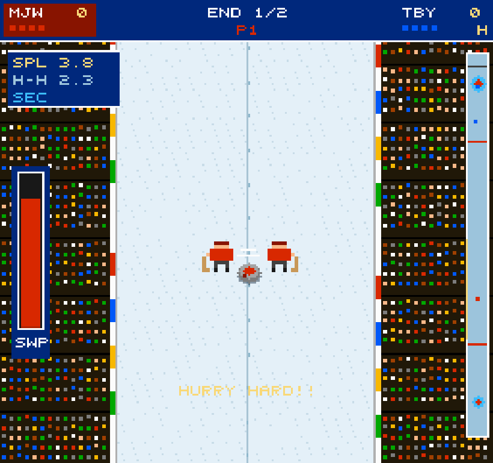

# CURLING '94

*HURRY HARD EDITION — © 1994 GRANITE GAMES*

A 90s-arcade curling game in the spirit of the 16-bit golden age: the
vertical-scrolling rink, crowd and rink-board ads of **NHL '94**, the
oscillating aim-arrow / power-meter mechanics of **Madden field goals**,
and the big flashing splash screens, skip portraits and trash talk of
**Punch-Out!!** and **Windjammers** — all rendered at a chunky 256×240
with a 5×5 pixel font and Web Audio chiptune bleeps.

Underneath the pixels the stones obey real curling physics.

| | | |
|---|---|---|
|  |  |  |

## Play it

No build step, no dependencies. Either open `index.html` directly, or:

```sh
python3 -m http.server 8000
# then visit http://localhost:8000
```

## How to play

**MOOSE JAW** (red) vs **THUNDER BAY** (blue). Throw your stones down the
sheet; closest to the button scores. Most points after the final end wins
(ties go to an extra end).

Each throw is a three-click field-goal routine, then a mash-to-sweep ride:

| Phase  | What happens | Controls |
|--------|--------------|----------|
| HANDLE | Commit to the curl direction first (in-turn / out-turn) | `←` / `→`, then `SPACE` |
| AIM    | The arrow oscillates left/right | `SPACE` to lock it |
| WEIGHT | The power meter oscillates — unmarked, so you learn your weights from the split times | `SPACE` to lock |
| SWEEP  | Stone is away! Sweeping carries it farther and straighter | mash `SPACE` (or `Z`/`X`) |

`ENTER` starts/advances menus. In the setup menu choose VS CPU or
2-player hot seat, stones per team per end (2/4/8), and number of ends.

The minimap on the right shows the whole sheet, every stone, and your
**broom line** while you aim — a straight line, like a skip's broom. The
stone curls off that line (~4 ft on a draw), so call your ice: aim a
few feet wide of the button and let the handle bring it home.

While a stone runs, the **stopwatch** (top-left) shows the split (SPL,
release to near hog) and hog-to-hog (H-H) in *real curling seconds* —
the clock runs on simulation time, so the numbers stay canonical no
matter how fast the game plays back. Draws run ~13-14s hog-to-hog,
takeouts ~7-9s, just like on real ice.

## The physics

- Real sheet dimensions: 4.75 m wide, hog-to-hog 21.95 m, 1.83 m
  (12-foot) house, with hog-line and back-line rules — a thrown stone
  that doesn't fully cross the far hog (and touched nothing) is pulled.
- Nominal ice decelerates a stone at 0.080 m/s², which makes a draw to
  the button read 14.0 s hog-to-hog with a 3.77 s split — in line with
  real timing tables.
- The handle curls the stone only once it slows below ~2 m/s: draws
  bend about 4.8 feet, normal hits barely flinch, peels run dead
  straight. The curve shape is calibrated against curling.gg's model.
- Sweeping lowers friction by up to 28% and removes most of the curl,
  so you can carry a light draw or hold a line.
- Collisions conserve momentum (equal mass, restitution 0.92):
  takeouts, raises and ports all work.
- Hammer goes to the team that gives up the end; blank ends keep it.
- Playback runs at 2.4× so a draw takes seconds, not half a minute. The
  physics underneath is in real metres and seconds, which is why the
  stopwatch reads real curling times.

## Development

No build step and no dependencies; the game is two plain scripts.

- `index.html` — shell page, pixel-scaled canvas
- `physics.js` — sheet geometry, the ice model, stone integration,
  collisions, offline shot simulation and the weight scale. Pure (no
  DOM), so tests load it directly. Ice is an object with `decelAt(y, z)`
  and `curlAt(y, z)`; everything asks the ice rather than reading a
  constant.
- `game.js` — state machine, input, CPU skip, rendering, sound
- `test/` — `npm test` runs the physics calibration tests (hog-to-hog
  and split times, curl, straight peels, collisions, frame-rate
  independence) and a full seeded game against the CPU
- `tools/shots.js` — `npm run shots` regenerates `shots/` in headless
  Chromium (needs playwright)
- `NOTES.md` — design log: playtest verdicts, locked-in values, backlog

Pushing to the default branch runs the tests and deploys the game files
to GitHub Pages.
